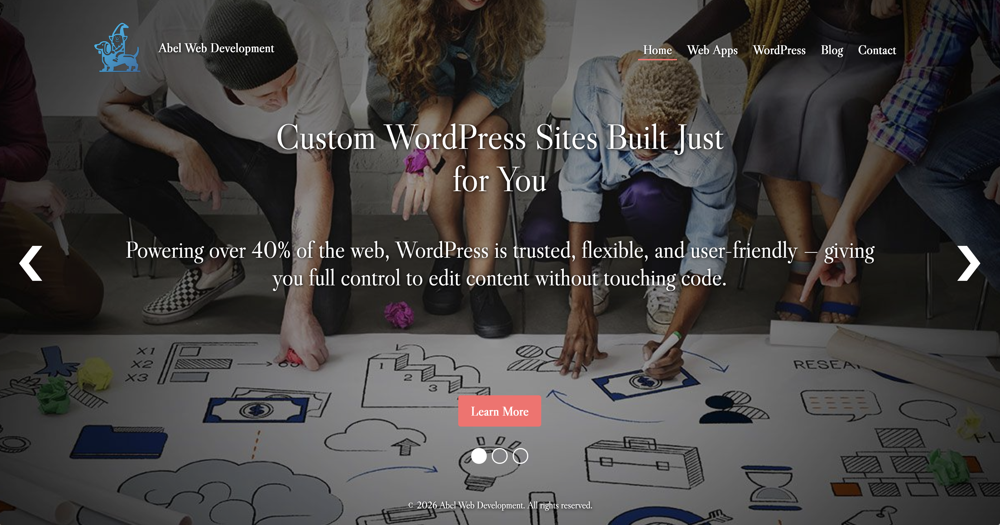
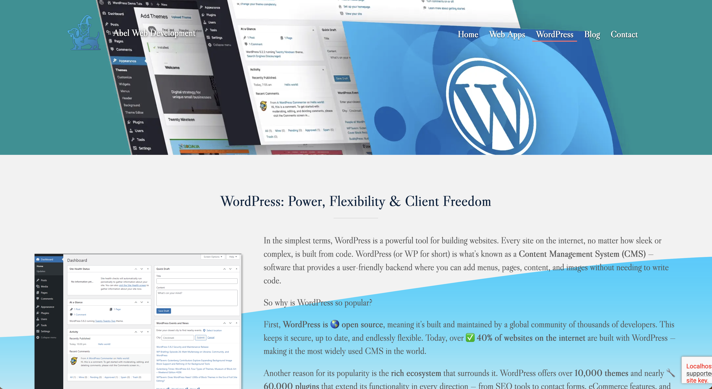
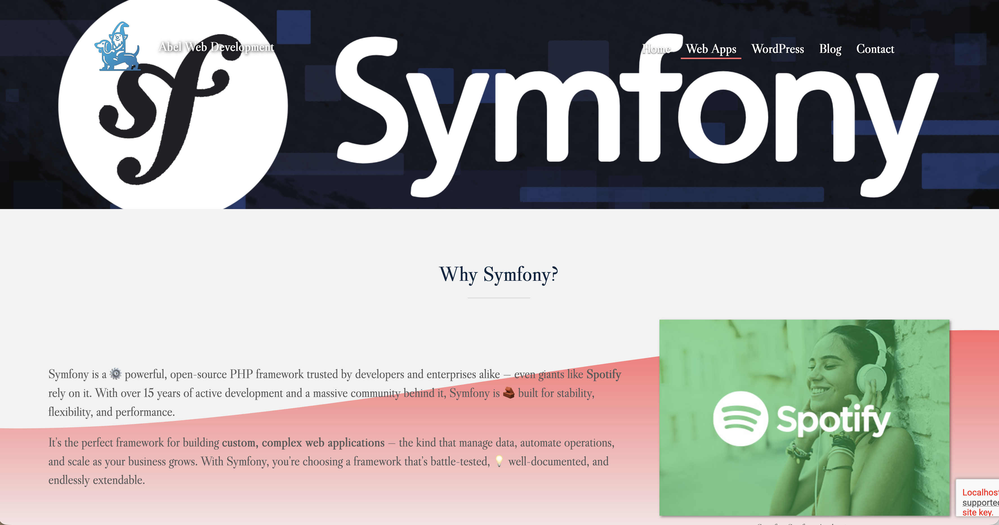
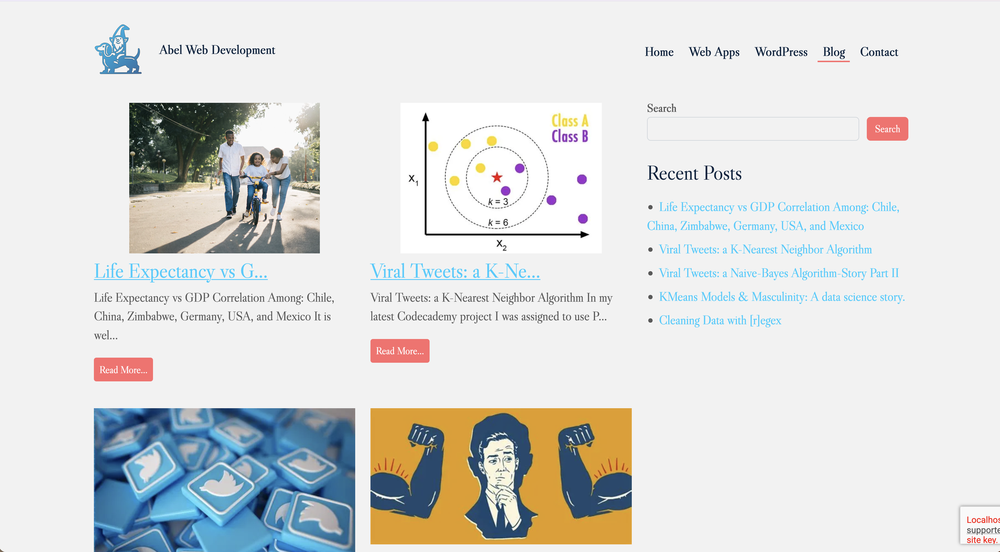
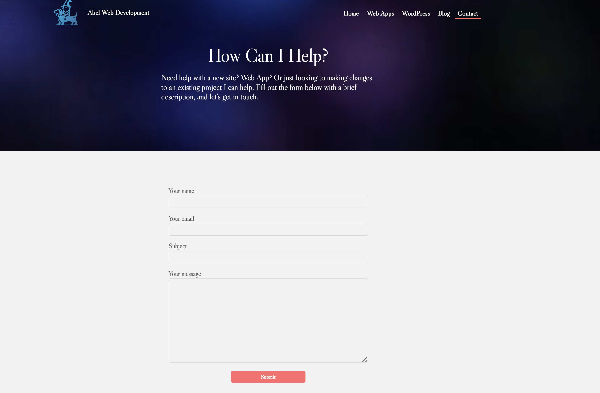

# Abel Web Development

A custom WordPress website built to showcase my web development experience, technical skills, and portfolio projects.

> This repository is a sanitized portfolio representation of a larger
> application. Proprietary business logic, production credentials, customer
> information, branding, and infrastructure details have intentionally been
> removed or replaced.

---

## Screenshots

---

## Technologies Used
- WordPress, PHP, JavaScript, HTML5, CSS3
- Bootstrap / Understrap
- Docker and Docker Compose
- MySQL
- Git and GitHub
Project Features
- Custom WordPress theme development
- Responsive frontend layouts
- Custom functionality and WordPress integrations
- Docker-based local development environment
Local Development

Instructions for configuring environment variables, starting Docker containers, importing a sanitized sample database if needed, and accessing WordPress locally.

Screenshots

Screenshots of the homepage, responsive layouts, and custom functionality.
